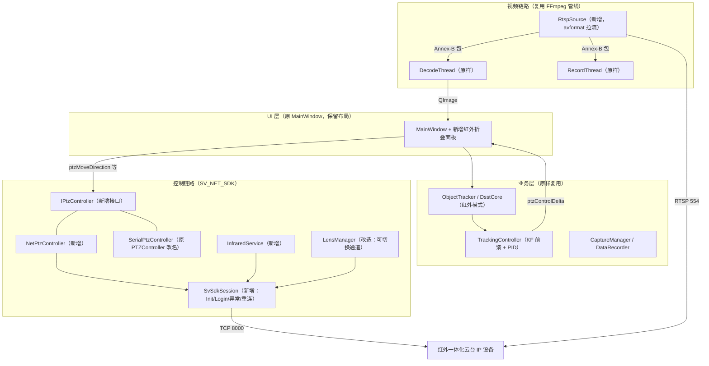

# 红外集成云台（以太网）上位机重构与移植主方案（修订版 v2）

> **修订说明（2026-11-07）**：v1 方案中关于 SDK 的多条结论，是依据"类海康 SDK"的经验推断出来的，没有和本目录实物逐一核对。v2 已逐项对照以下实物：
> - `sdk/include/SVNETSDK.h`（GBK 编码，1966 行）
> - `sdk/lib/x64/SV_NET_SDK.dll` / `PlaySRenderCtrl.dll` 的导出符号与依赖 DLL
> - 官方 Qt C++ 示例 `sdk/demo/sdkdemo`（`sdkdemo.cpp`、`play_ctrl.cpp`、`pic_config.cpp`）
> - `上位机与客户端/FocusControl 0520(1).exe`
> - 原工程 `D:\RGB_PTZ_demo` 源码（`ptzcontroller.*`、`devicemanager.*`、`mainwindow.cpp`、`DecodeThread.h`、`.pro`）
>
> 第 0 章给出评审结论和问题清单，后续章节是修订后的完整方案。

---

## 0. 评审结论

### 0.1 总体判断

| 项 | 结论 |
| :--- | :--- |
| 总体方向（保留 UI、跟踪算法、主要功能，只替换通信层） | ✅ **可行**。原工程分层清晰，跟踪→伺服只经过 `ptzMoveDirection(cmd2,h,v)` 这一个信号，替换成本低 |
| v1 的 SDK 技术细节 | ❌ **有 15 处与实物不符**，其中 3 处属于阻断级风险，开工前必须先上硬件验证（见 0.2） |
| 视频链路 | 🔁 **已改为更优方案**：走设备 RTSP，复用原工程 FFmpeg 管线（`DecodeThread` / `RecordThread` 原样不动），SDK 只负责控制和测温 |
| 编译链 | 🔁 **已改为更优方案**：继续使用 MinGW 64 + Qt 6.12，不切换 MSVC（切换要重编 OpenCV，没有收益） |
| 工期 | 🔁 新增 **Phase 0 硬件摸底（1~1.5 天）** 作为决策闸口，总工期约 9~10 人天 |

### 0.2 问题清单（v1 说法 → 实物核查 → 修订）

| # | 级别 | v1 说法 | 实物核查结果 | 修订 |
| :--- | :--- | :--- | :--- | :--- |
| 1 | 🔴阻断 | 速度范围 1~63，控制延迟 15ms→2ms | 官方 demo 原文注释：`int g_dwSpeed = 0; //目前不知道云台是否有速度映射`，默认走**不带速度**的接口。固件低于 V1.6.4 时，PTZ 控制必须"先开启透明通道，请注意区分 RS485 或者 RS232"，说明**机内仍然是用串口驱动云台**。速度档位和端到端延迟**都不清楚** | Phase 0 实测速度档位与延迟；速度映射做成可配置；准备好"设备不支持调速"的降级策略（4.3.4） |
| 2 | 🔴阻断 | `GetPtzPosition` **或 `GetSZDWInfo`** 回传角度，精度 0.001° | `SV_NET_DEV_SZDW_INFO` 只有 `wDevId/wServPort/lpServIp/byPsdc`，**和角度无关**。`SV_NET_DEV_PTZPOS.wPanPos/wTiltPos` 是 `WORD`（无符号），**俯仰负角没法直接表示**，单位编码（0.1° / 0.01° / 海康式 BCD）未知。带 float 的 `SV_NET_DEV_PTZ_INFO_EX` 标注为"此版本暂不支持"。**官方 demo 从来没调用过 `GetPtzPosition`** | Phase 0 验证；解码方式做成可配置；不支持时启用降级（4.4）。跟踪闭环本身只用像素脱靶量，**不依赖角度** |
| 3 | 🔴阻断 | 镜头通过 SDK `dwThermalFocus` 或透传通道控制 | `dwThermalFocus` 只出现在"此版本暂不支持"的结构体里。SDK **没有定义 ZOOM/FOCUS 宏**（只有 21~44 号命令）。demo 中 `On_pushButton_zoomA/focusA` **函数体是空的**，只留了一行私有帧注释 `A50F0110000010D5`。`FocusControl.exe` 是 MFC **串口**工具（含 `CSerialPort`、`COM%d`、`BuildCommDCB`）。`START_SERIALTRANS` 只能"开启"，SDK 里没有对应的收发 API；能发送的只有 `SV_NET_DEV_TransPTZ`，而且**无法回读** | 镜头控制降为 P2，需要厂家提供调焦板协议；`LensManager` 底层做成可切换通道（网络 TransPTZ / 本地串口） |
| 4 | 🟠高 | SDK 导出符合 `extern "C" __stdcall` 规范 | 头文件 Windows 分支中 `SV_NET_SDK_API` 只是 `__declspec(dllexport)`，**没有 `extern "C"`**；DLL 实际导出的是**未修饰的 C 名**。C++ 直接 include 会出现链接错误（官方 `pic_config.cpp` 就是用 `extern "C" { #include }` 包起来的） | 新增 `svsdk.h` 包装头（见 03 手册 §3.1） |
| 5 | 🟠高 | 推荐整体切换到 MSVC 2019/2022 | 原工程是 MinGW Qt 6.12 + **MinGW 版 OpenCV** + FFmpeg 8.1。x64 下 `__stdcall` 不做名字修饰，SDK 又是纯 C 接口，MinGW 可以直接链接 | **保持 MinGW**；Phase 0 用约 50 行的控制台程序验证链接；兜底方案是 `QLibrary` 运行时加载 |
| 6 | 🟠高 | RealPlay 回调吐出 H.264 码流，交给原 `DecodeThread` | 回调签名 `(lPlayHandle, dwDataType, pBuffer, unWidth, unHeight, pUser)` **没有数据长度**；demo 中回调数据是**已解码的 BGR24**，或者 14bit 原始数据（`TYPE_RGB16`，末尾 2 行是附加信息）。所以既不能喂 `DecodeThread`，也不能喂 `RecordThread`（这两者都只接收 Annex-B 码流） | **主路径改为 RTSP**：DLL 内置了 URL 模板 `rtsp://%s:%s@%s/Streaming/Channels/101/H264`；SDK 回调作为备选（4.2） |
| 7 | 🟡中 | 运行库是 `msvcp140` / `msvcr120`；0xc000007b 是 CRT 混用造成的 | 实际依赖：`SV_NET_SDK.dll` → **MSVCR120 / MSVCP120（VC2013）** + `pthreadVC2` + `PlaySRenderCtrl`；`PlaySRenderCtrl` → **FFmpeg 4.x（avcodec-58 等）** + `SDL2`。0xc000007b 一般是 **32/64 位混放**造成的 | 部署清单已更正（第 6 章）；FFmpeg 4.x 和 8.x 的文件名不同，可以放在同一目录 |
| 8 | 🟡中 | 机芯实时返回最高温坐标，可用于重捕获 | `GetThmlMtFSMaxMinVal(lUserID, float*)` 在 demo 里只用了 `float[2]` = {最高温, 最低温}，**没有坐标，也没有平均温** | 热点坐标改为在本地灰度图上计算（4.5.3），不依赖 SDK |
| 9 | 🟡中 | "新增" 300ms 看门狗；"激活" `m_infraredMode` | 原工程**已经有** 500ms 失联看门狗（`m_stopWatchdog`）和方向盘周期重发；`DsstCore`/`ObjectTracker`/`TrackingController` **已经有**红外单通道模式，UI 下拉框 index==1 即可切换 | 直接复用，不算新增工作量 |
| 10 | 🟡中 | FHOG cell size 从 4 调到 2 | 计算量约增加 4 倍，红外低纹理场景下收益不确定 | 删除这一条，保持默认参数，以实测结果调参 |
| 11 | 🟡中 | 伪彩可以随意切换 | 码流是伪彩后再编码的；铁红、彩虹等伪彩转成灰度后**亮度不单调**，会破坏 DSST 的灰度特征 | 跟踪期间锁定白热/黑热（4.5.2） |
| 12 | 🟡中 | 一键 / 定时 FFC | 打挡片期间画面会冻结约数百毫秒，跟踪器和 PID 会误判 | 跟踪中把 FFC 切到手动模式，或在 FFC 期间冻结伺服输出（4.6） |
| 13 | 🟡中 | NetPtz 每帧同步下发 | SDK 的 PTZ 接口是**同步阻塞**的（一次网络往返）；25Hz 逐帧下发会堆积 | 命令去重合并：状态没变就不下发，只刷新看门狗（4.3.2） |
| 14 | 🟢低 | 端口 37777/8000；SV_ISDP 负责心跳；PlaySRenderCtrl 是 D3D 渲染 | demo 默认端口 **8000**；`SV_ISDP` 是**设备搜索**（SADP）；渲染基于 **SDL2** | 已更正 |
| 15 | 🟢低 | 8 天工期，没有安排硬件验证 | 上面 3 个阻断项都只能上实物确认 | 新增 Phase 0 闸口（第 7 章） |

### 0.3 v2 相对 v1 的主要改进

1. **视频链路少重写约 70%**：RTSP + 原 FFmpeg 管线，`DecodeThread`、`RecordThread`、`CaptureManager` 全部原样复用；SDK 视频 DLL 只在备选路径中用到。
2. **抽象层更薄**：只抽象 `IPtzController`（这是唯一真正需要"可替换"的部件），再加一个共享的 `SvSdkSession`；去掉 v1 中的 `ICameraDevice`（视频改走 RTSP 后，它就没有第二个实现了）。
3. **风险前置**：Phase 0 用半天到一天把速度、角度、镜头三个未知项查清，再决定后续路径，避免返工。
4. **红外专项更稳**：处理了伪彩对跟踪的影响和 FFC 冻结帧问题；热点辅助改为本地计算。

---

## 1. 项目背景与目标

### 1.1 背景
现有系统 `D:\RGB_PTZ_demo`：Qt 6.12 + MinGW 64，Univision 可见光相机 SDK（视频与镜头）+ RS-485 Pelco-D 云台（9600bps），FFmpeg 8.1 解码与录像，DSST + KF + PID 前馈伺服跟踪。

新硬件 `D:\IRPTZ_demo`：红外热像机芯与云台一体化，**对 PC 只引出一根网线**，SDK 为 `SV_NET_SDK`（接口风格与海康 HCNetSDK 同源，头文件宏名为 `_HC_SV_NET_SDK_H_`）。

### 1.2 目标与原则
1. **保留**：原 UI 布局与交互、DSST/KF/PID 算法、抓拍/录像/数据记录等主干功能。
2. **替换**：云台通信从串口 Pelco-D 改为 SDK 网络接口；视频源从 Univision SDK 改为 RTSP。
3. **新增**（增量、可折叠）：FFC、伪彩、全屏最高/最低温、点测温、温度矩阵抓取。
4. **质量**：所有未经实物验证的 SDK 能力都先验证、再接入，并且要有降级路径。

---

## 2. 新旧系统对照（已按实物核对）

| 维度 | 原系统 | 新系统（实物核查） | 适配策略 |
| :--- | :--- | :--- | :--- |
| 编译链 | MinGW 64 / Qt 6.12 | SDK 为 MSVC 编译的 C 接口 DLL（x64 / x86 均有） | 继续用 MinGW，`extern "C"` 包装后链接 |
| 登录 | `UNIV_DEV_Login` | `SV_NET_DEV_Login(&loginInfo,&devInfo)`，默认端口 **8000** | `SvSdkSession` 统一管理 |
| 视频 | SDK 回调 Annex-B → `DecodeThread` | 设备支持 RTSP：`/Streaming/Channels/101`（主）、`102`（子），另有 `201/202`（第二通道，用途待确认） | **RTSP → FFmpeg → 原管线** |
| 云台 | 串口 Pelco-D，cmd2 位掩码 | `SV_NET_DEV_PTZControlWithSpeed_EX(user, ch, cmd, stop, speed)`，命令码 21~28（demo 中已使用）；固件 < V1.6.4 要走透明通道 + 旧接口 | `NetPtzController`，按固件版本选择接口 |
| 速度 | Pelco 0~63 | **未知**（demo 注释说"不知道有没有速度映射"） | 可配置映射表，Phase 0 实测 |
| 角度 | Pelco 0x51/0x53 查询 | `GetPtzPosition` 已声明，但 demo 没用过；`WORD` 类型，编码未知 | Phase 0 验证；配置解码方式；有降级路径 |
| 预置位 | Pelco 0x03/0x07/0x05 | `PTZPreset_EX(user,ch,SET/RUN/CLE_PRESET,idx)`（demo 已使用） | 直接映射 |
| 绝对定位 | Pelco 0x4B/0x4D | `SetPtzPosition`（已声明，未验证） | Phase 0 验证；不支持就禁用 `moveTo` |
| 镜头 | SDK Zoom/Focus/Iris | SDK 中**无对应接口**；调焦板走串口私有协议 | P2，要厂家协议 |
| 红外功能 | 无 | FFC：`CTRL_CORE_FFC`（背景）/ `CTRL_CORE_SHUTR`（快门）/ `SetFFCMode`；伪彩：`CTRL_CORE_GEN(0x08, 1..12)`；最高/最低温：`GetThmlMtFSMaxMinVal`；点温：`GetThmlManualMtConfig`；温度矩阵：`CaptureTEMPData`（以上 demo 均已使用） | `InfraredService` |

---

## 3. 总体架构

### 3.1 分层与数据流

### 3.2 模块改动一览

| 模块 | 动作 | 说明 |
| :--- | :--- | :--- |
| `IPtzController`（新） | 新增 | 从原 `PTZController` 公共接口中提取，**信号名不变**（`angleReceived`、`rawDataInout`、`serialError`），这样 MainWindow 的 connect 只需改类型名 |
| `SerialPtzController` | 改名 | 原 `PTZController` 继承 `IPtzController`，逻辑不动，作为备用 |
| `NetPtzController`（新） | 新增 | 方向映射、速度映射、去重合并、看门狗、角度轮询、固件版本分支 |
| `SvSdkSession`（新） | 新增 | `SDK_Init/Release`、`Login/Logout`、`SetExceptionCallBack`、解析固件版本（≥V1.6.4 判定）；对外提供线程安全的 `userId()` |
| `RtspSource`（新） | 新增 | FFmpeg 拉流线程，输出 Annex-B `QByteArray` 给原 `DecodeThread::pushData` / `RecordThread::pushData` |
| `DeviceManager` | 中改 | 登录改走 `SvSdkSession`；`startStream/stopStream` 改为启停 `RtspSource`；去掉 Univision OSD 相关接口 |
| `LensManager` | 中改（P2） | `LensWorker` 底层改成可切换的发送通道；按钮槽函数签名不变 |
| `InfraredService`（新） | 新增 | 独立工作线程，低频轮询温度（≤2Hz），FFC 和伪彩命令 |
| `DsstCore` / `ObjectTracker` / `TrackingController` | 不改 | 只是默认开启红外模式；`TrackingController` 增加"伺服冻结"开关（FFC 期间使用） |
| `MainWindow` | 小改 | 指针类型改为 `IPtzController*`；用"网络云台 / 串口云台"选项替代串口面板；挂上红外折叠面板 |

---

## 4. 关键技术方案

### 4.1 SDK 接入与编译链（保持 MinGW）

1. **包装头 `svsdk.h`**：先定义 `NOMINMAX`、`WIN32_LEAN_AND_MEAN`，再 `#include <winsock2.h>` / `<windows.h>`，然后用 `extern "C" { #include "SVNETSDK.h" }` 包住。所有业务代码只 include `svsdk.h`。
2. **链接**：`LIBS += -L$$SDK_DIR/lib/x64 -lSV_NET_SDK`（MinGW ld 可以识别 MSVC 生成的 C 接口导入库）；如果不行，改为直接链接 `SV_NET_SDK.dll`。
3. **兜底**：如果 Phase 0 发现头文件在 GCC 下编译不过（例如 `#pragma warning`、重复声明等问题），改用 `QLibrary` 加载**本项目实际用到的约 20 个函数**（列表见 03 手册 §2）。
4. **跨 CRT 安全**：SDK 接口只传 POD 结构体和裸指针，不跨 DLL 传 `std::` 对象或 `FILE*`，MinGW 与 VC2013 CRT 可以共存。
5. **只编 x64**：避免 0xc000007b。

### 4.2 视频链路：RTSP 主路径 + SDK 回调备选

#### 4.2.1 主路径（推荐）：RTSP → 原 FFmpeg 管线
- URL 模板做成可配置，默认值 `rtsp://{user}:{pwd}@{ip}:554/Streaming/Channels/101`（来自 DLL 内置字符串；末尾的 `/H264` 可省略，以 Phase 0 实测为准）。密码要做 URL 编码。
- `RtspSource`（`QThread`）：`avformat_open_input`（选项 `rtsp_transport=tcp`、`timeout=3000000`、`fflags=nobuffer`、`flags=low_delay`、`max_delay=200000`）→ `av_read_frame` → 关键帧前补上 `extradata`（Annex-B 形式的 SPS/PPS）→ 推给 `DecodeThread::pushData`，录像时同时推给 `RecordThread::pushData`。
- 根据 `codecpar->codec_id` 设置 `setEncType`（H264=0，HEVC=3），与原接口语义一致。
- 断流后指数退避重连（1s→2s→4s，上限 8s），不依赖 SDK 的异常回调。
- **好处**：`DecodeThread` / `RecordThread` / `CaptureManager` 零改动，跟踪框叠加和录像逻辑保持不变；与 SDK 播放库完全解耦。

#### 4.2.2 备选路径：SDK 回调（RTSP 不可用时启用）
- `PREVIEWINFO.hPlayWnd = NULL`，注册 `REALDATACALLBACK`。回调中的 `pBuffer` 是解码后的 BGR24（`unWidth*unHeight*3`），直接构造 `QImage` 并发给 `frameReceived`，**跳过** `DecodeThread`。
- 录像改用 `SV_NET_DEV_SaveRealData(lRealHandle, path)`（设备原始码流直存），`RecordThread` 不参与。
- 14bit 原始流（`byVideoCodingType=2`，`TYPE_RGB16`）只在需要逐帧测温时使用，要自己做 AGC（参考 demo 中的 `auto_gain_ctrl`）。

#### 4.2.3 延迟预算
跟踪闭环延迟 ≈ 视频延迟（RTSP 低延迟配置下通常 120~250ms）+ 跟踪处理 + PTZ 下发。原工程的 KF 速度前馈可以补偿一部分；Phase 0 用"秒表画面对拍"实测视频延迟，据此调整 `Kff`。

### 4.3 云台控制：`NetPtzController`

#### 4.3.1 方向映射
- Pelco `cmd2` 位掩码 → SDK 命令码：上 `0x08`→`TILT_UP(21)`，下 `0x10`→`TILT_DOWN(22)`，左 `0x04`→`PAN_LEFT(23)`，右 `0x02`→`PAN_RIGHT(24)`，组合后对应 `UP_LEFT(25)` / `UP_RIGHT(26)` / `DOWN_LEFT(27)` / `DOWN_RIGHT(28)`。
- **主次轴处理**：SDK 只有一个速度参数。如果次轴速度小于主轴速度的 30%，就只发主轴方向，避免斜向运动时次轴被强行拉到主轴速度、引起过冲。
- **固件分支**：`SvSdkSession` 登录后解析 `softwareVersion`，≥V1.6.4 用 `PTZControl(WithSpeed)_EX(user, ch=0, …)`；否则先 `START_SERIALTRANS(user, 2/*RS485*/)`，再用 `PTZControl(WithSpeed)(user, …)`（与 demo 逻辑一致）。

#### 4.3.2 下发节流（去重合并）
- 跟踪每帧都会发 `moveDirection`。只有当 `(cmd, speed)` 和上次不同时才调用 SDK；相同则只刷新看门狗。
- 可选 `resendIntervalMs`（默认 0 = 不重发）：只有当 Phase 0 发现设备自带"运动超时自动停止"时才打开。
- 所有 SDK 调用都在 PTZ 工作线程里**串行**执行，不需要额外加锁。

#### 4.3.3 停止语义
demo 使用 `PTZControl_EX(user, ch, 0, 1)` 停止。为兼容海康式"同一命令 + stop=1"的语义：如果返回失败，再用上一次的运动命令补发一次 `stop=1`。

#### 4.3.4 速度映射与"不支持调速"降级
- 配置项 `ptz/speedMin`、`ptz/speedMax`、`ptz/speedCurve`（线性 / 查表），把 Pelco 0~63 映射到设备档位。
- Phase 0 用固定的时间窗口测量各档位的角速度，生成查表。
- **如果设备不支持调速**：①PID 输出改成"脉宽调制"——在 200ms 周期内按比例发运动/停止；②如果 `SetPtzPosition` 可用，改为位置环（当前角度 + 像素误差折算出的角度增量）。两种方式二选一，以 Phase 0 结果决定。

### 4.4 角度回传
- 默认 10Hz 轮询 `GetPtzPosition(user, ch=0, lPositionID=0, &pos)`，调用前把 `pos` 清零。
- 解码方式可配置：`deci`（/10）、`centi`（/100）、`bcd`（海康式十六进制 BCD，例如 0x3599 → 359.9°）。俯仰按 `>180 ⇒ -360` 回绕。
- 角速度由相邻两次采样做差分后低通得到，填入 `angleReceived` 的 `panSpeed/tiltSpeed`。
- **降级**：如果接口返回失败或数值不随运动变化，就关闭轮询，界面角度显示为"--"，`DataRecorder` 记为 NaN；**跟踪闭环不受影响**（只依赖像素脱靶量）；`moveTo` 和角度限位相应禁用。

### 4.5 跟踪算法适配（不改核心）

#### 4.5.1 复用现有红外模式
UI 跟踪源下拉框默认选"红外"（index 1）→ `TrackingController::setInfraredMode(true)` → `DsstCore` 改用单通道灰度特征（`m_numFeatures=1`）。算法参数保持默认，以实测数据调整。

#### 4.5.2 伪彩约束
跟踪开始时，如果当前伪彩不是白热或黑热，自动切到白热（`CTRL_CORE_GEN(0x08,1)`）并提示；跟踪结束后恢复用户之前的选择。这是为了避免伪彩转灰度后亮度不单调造成的特征失真。

#### 4.5.3 热点辅助重捕（本地计算）
在跟踪丢失（PSR 低于阈值）时，在上一帧目标位置附近 2~3 倍的搜索框内，对灰度图做高百分位阈值 + 连通域分析，取面积和亮度加权最大的热斑作为重检候选，交给 DSST 重新初始化。纯 OpenCV `imgproc` 实现，耗时 < 1ms，不依赖 SDK。

### 4.6 安全保护（在原有机制基础上补齐）

| 机制 | 现状 | v2 动作 |
| :--- | :--- | :--- |
| 失联看门狗 | 原 `PTZController` 已有 500ms | `NetPtzController` 同样实现 500ms（单次触发，每次 `moveDirection` 刷新） |
| 方向盘周期重发 | 原 MainWindow 已有（周期 < 看门狗） | 保留 |
| 目标丢失停机 | 已有 Lost 状态 | 确认连续丢失 N 帧（默认 15）后发 `stop` |
| 积分抗饱和 | 待确认 | 脱靶量超过画面半径 85% 时冻结积分 |
| FFC 冻结 | 无 | 跟踪中把 FFC 设为手动（`SetFFCMode(MANUAL)`），停止跟踪后恢复；用户手动打挡片时伺服冻结 800ms |
| 网络异常 | 无 | `SetExceptionCallBack` 收到 `EXCEPTION_NETWORK` / `DEVOFFLINE` 时：PTZ 进入断开状态、跟踪暂停；收到 `SUCCESS_RECONNECT` 时恢复 |
| 退出安全 | 已有 `prepareForDestruction` | 在其中以阻塞方式同步发送 `stop`，然后 `Logout`，最后 `SDK_Release` |

### 4.7 红外功能（`InfraredService`）

| 功能 | API（demo 已验证） | 说明 |
| :--- | :--- | :--- |
| 背景 FFC / 快门 FFC | `CTRL_CORE_FFC` / `CTRL_CORE_SHUTR` | 两个按钮，并联动 4.6 的伺服冻结 |
| FFC 模式 | `GetFFCMode` / `SetFFCMode(SHUTTER_MODE_AUTO/MANUAL)` | 下拉框 |
| 伪彩 | `CTRL_CORE_GEN(user, 0x08, 1..12)`（1=白热、2=黑热、3=铁红、4=彩虹、5=红热、6=冰雨…） | 跟踪时受 4.5.2 约束 |
| 全屏最高/最低温 | `GetThmlMtFSMaxMinVal(user, float buf[4])`，取 `buf[0]`=最高、`buf[1]`=最低；**返回 0 表示成功** | 2Hz 轮询，用 OSD 显示 |
| 点测温 | `GetThmlManualMtConfig(user, POINT_S32_S, &t)`；**返回值 > 0 表示成功** | 坐标系（传感器像素还是 0~1000 归一化）要在 Phase 0 确认 |
| 温度矩阵 | `CaptureTEMPData(user, 0, SHORT*, &size)` | 存为 `.raw` 并附带 `.json` 元数据 |
| 发射率等参数 | `Get/SetThmlMtBasicParamConfig` | P2 |

> 注意：各 API 的成功返回值约定**不一致**，封装时要逐个处理，不能统一用 `ret < 0` 判断失败。

### 4.8 镜头控制（P2）
- 现状：SDK 里没有变倍/调焦接口；调焦板由 `FocusControl.exe` 通过 **PC 串口**控制，协议私有（demo 注释里出现过 `A5 0F 01 10 …` 格式的帧）。
- 方案：`LensWorker` 抽象出 `ILensTransport`，有两个实现：`SdkTransPtzTransport`（`SV_NET_DEV_TransPTZ` 下发到机内串口，只写不读）和 `SerialLensTransport`（`QSerialPort` 直连调焦板）。帧格式由厂家协议决定。
- 在拿到协议之前，UI 镜头按钮置灰，并提示"需厂家调焦协议"。`.pro` 保留 `serialport` 模块。

---

## 5. UI 调整
- 连接面板：IP / 端口（默认 8000）/ 用户名 / 密码 / RTSP 通道（101 主码流、102 子码流）；点"连接设备"依次完成 SDK 登录、RTSP 拉流、PTZ 会话建立。
- 云台面板：原九宫格和预置位保持不变；新增"云台类型：网络 / 串口（备用）"，串口参数折叠起来。
- 镜头面板：保留按钮，按 4.8 的状态置灰或启用。
- 新增"红外"折叠面板：FFC（背景 / 快门 / 模式）、伪彩、温度 OSD 开关、点测温开关、温度矩阵抓取。
- 视频区：沿用原 `QLabel` 框选和叠加绘制；增加最高/最低温 OSD 文本（因为 SDK 不返回坐标，所以不画十字）。

---

## 6. 依赖与部署（x64）

| 类别 | 文件 | 来源 |
| :--- | :--- | :--- |
| SDK | `SV_NET_SDK.dll`、`SV_ISDP.dll`（设备搜索，可选）、`PlaySRenderCtrl.dll` | `sdk/lib/x64` |
| SDK 运行库 | `msvcr120.dll`、`msvcp120.dll`、`pthreadVC2.dll` | `sdk/lib/x64` |
| 播放库依赖（`SV_NET_SDK` 加载时会连带加载） | `avcodec-58`、`avformat-58`、`avutil-56`、`swscale-5`、`swresample-3`、`SDL2.dll` | `sdk/lib/x64` |
| 原工程 | FFmpeg 8.1（`avcodec-62` 等）、OpenCV 4.10 MinGW、Qt 6.12 MinGW 运行时 | 原样 |

> FFmpeg 4.x 和 8.x 的 DLL 文件名不同，可以放在同一个输出目录。`.pro` 的 `QMAKE_POST_LINK` 增加以上 SDK 文件的复制，删除 `univisionsdk.dll`。

---

## 7. 实施计划（含决策闸口）

| 阶段 | 工期 | 内容 | 交付 / 闸口 |
| :--- | :--- | :--- | :--- |
| **Phase 0 硬件摸底** | 1~1.5 天 | ①MinGW 链接 SDK 的控制台测试 ②登录与固件版本 ③RTSP URL 与延迟 ④八方向、停止、各速度档位的角速度 ⑤`GetPtzPosition` 是否可用及其编码 ⑥`SetPtzPosition` ⑦预置位 ⑧FFC、伪彩、温度 API 的返回值与坐标系 ⑨镜头控制通道（向厂家要协议） | 《Phase 0 验证报告》；据此确定：速度策略（调速 / PWM / 位置环）、角度降级与否、视频主/备路径 |
| Phase 1 控制基础 | 2 天 | `svsdk.h`、`SvSdkSession`、`IPtzController`、`NetPtzController`、`SerialPtzController` 改名、MainWindow 接线 | 手动控制、预置位、角度显示（或降级）全部通过；拔网线后 500ms 内停止 |
| Phase 2 视频接入 | 1.5 天 | `RtspSource`、改造 `DeviceManager`、部署脚本 | 实时画面、抓拍、MP4 录像；断流后能自动重连 |
| Phase 3 闭环联调 | 2 天 | 红外模式、伪彩约束、去重合并、速度映射或降级控制、丢失停机、FFC 冻结 | 典型目标（人、车）稳定跟随；遮挡后能停机或重捕 |
| Phase 4 红外增强与验收 | 2 天 | `InfraredService`、红外面板、热点辅助重捕、(P2) 镜头 | 功能清单通过；连续运行 4 小时无崩溃、无失控 |

---

## 8. 风险登记

| 风险 | 概率 | 影响 | 应对 |
| :--- | :--- | :--- | :--- |
| 设备不支持调速，或档位很少 | 中 | 跟踪平滑度明显下降 | 4.3.4 的 PWM 控制或位置环 |
| `GetPtzPosition` 不可用 | 中 | 没有角度显示和记录 | 4.4 的降级；向厂家索取查询方式 |
| 机内串口转发延迟大（> 50ms） | 中 | 伺服滞后、出现振荡 | 降低 Kp，提高 Kff，加大死区 |
| RTSP 延迟偏高 | 中 | 闭环滞后 | 低延迟参数、改用子码流、或切到 SDK 回调备选路径 |
| SDK 头文件在 GCC 下编译不过 | 低 | 编译受阻 | 改用 `QLibrary` 动态加载 |
| 镜头协议拿不到 | 中 | 无法远程调焦 | 镜头功能延后，先用 FocusControl.exe 现场调焦 |

---

## 9. 结论
方案**整体可行**。v1 的架构方向是对的，但多处 SDK 细节与实物不符，若直接按 v1 开工，会在视频链路（回调格式）、编译链接（`extern "C"`）、角度回传（`GetSZDWInfo`）和镜头控制四处返工。v2 采用"RTSP 复用原管线 + 只抽象 PTZ + Phase 0 闸口"，在保证原 UI 和算法不动的前提下，把未知风险集中到开工前 1~1.5 天内解决。
