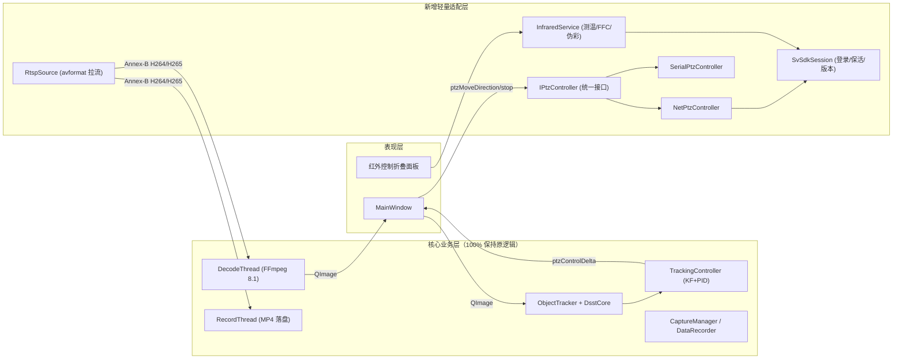
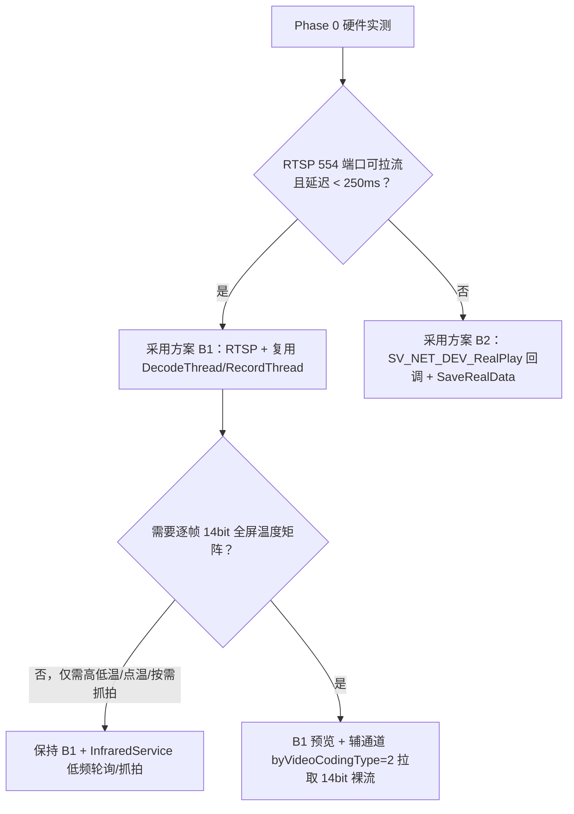

# 软件架构对比与选型指南（修订版 v2）

> **修订说明（2026-11-07）**：基于对 `D:\IRPTZ_demo\sdk`（头文件、DLL 导出表、官方 `sdkdemo` 源码）与 `D:\RGB_PTZ_demo` 现有工程的实物核查，v1 方案在架构选型上遗漏了一个关键事实——**`SV_NET_SDK` 的 `REALDATACALLBACK` 并不回调 H.264/H.265 压缩码流，而是回调已解码的 BGR24 像素或 14bit 原始测温数据，且回调签名没有缓冲区字节长度参数**。这意味着 v1 中“SDK 回调直接喂给原 `DecodeThread` / `RecordThread`”的设想在代码层面无法成立。
>
> 本修订版从**控制层抽象度**与**视频流接入路径**两个正交维度重新梳理架构选型，给出经过代码核验的最优选型（**方案 B-RTSP**）与备选降级路径（**方案 B-SDKCB**）。

---

## 一、架构决策的核心约束与实物发现

在对比架构方案前，必须明确核查出的四条客观约束：

1. **原工程耦合边界非常清晰**：
   - 在 `D:\RGB_PTZ_demo` 中，`ObjectTracker`、`DsstCore`、`TrackingController` 与硬件 SDK **完全零耦合**；
   - 跟踪闭环与云台的唯一交汇点是 `MainWindow::onPtzControlDelta` 发射的 `ptzMoveDirection(uint8_t cmd2, uint8_t hSpeed, uint8_t vSpeed)` 与 `ptzStop()` 信号；
   - 视频解码与录像的唯一入口是 `DecodeThread::pushData(const QByteArray&)` 与 `RecordThread::pushData(const QByteArray&)`，要求输入为 **Annex-B 格式的 H.264/H.265 压缩包**。
2. **新 SDK 的视频回调格式不兼容原解码/录像线程**：
   - `REALDATACALLBACK(LONG lPlayHandle, DWORD dwDataType, BYTE *pBuffer, DWORD unWidth, DWORD unHeight, void* pUser)` 只有宽高、没有 `dwBufSize`；
   - 官方 `play_ctrl.cpp` 证实：常规模式下 `pBuffer` 为已解码 BGR24（`unWidth * unHeight * 3` 字节），裸流模式下为 16bit 探测器数据（`TYPE_RGB16`，高 `unHeight - 2`）；
   - 同时，`SV_NET_SDK.dll` 二进制内嵌了标准 RTSP 地址模板：`rtsp://%s:%s@%s/Streaming/Channels/101/H264`（以及 `102`、`201`、`202`）。
3. **云台与相机共享同一个 SDK 登录会话（`lUserID`）**：
   - 原系统中串口 `PTZController` 与网络 `DeviceManager` 完全独立；
   - 新系统中 `NetPtzController`、`InfraredService`、`DeviceManager` 都依赖 `SV_NET_DEV_Login` 返回的 `lUserID`，因此需要一个轻量级的共享会话层 `SvSdkSession`，而不是各自登录。
4. **部分 SDK 能力未经官方 Demo 验证**：
   - `SV_NET_DEV_GetPtzPosition`（角度查询）、`SV_NET_DEV_SetPtzPosition`（绝对定位）、云台速度映射（`g_dwSpeed`）、热成像镜头调焦均存在硬件不确定性，架构上必须支持**配置切换与优雅降级**。

---

## 二、总体架构方案全景对比

我们将架构选型分为三个大方向，并在推荐的 **方案 B** 内部细分为 **B1（RTSP 主路径）** 与 **B2（SDK 回调备选路径）**：

| 评估维度 | 方案 A：极简就地修改<br>(In-Place Patch) | 方案 B1：轻量 HAL + RTSP 复用管线<br>(Lightweight HAL + RTSP) 【首选】 | 方案 B2：轻量 HAL + SDK 帧回调<br>(Lightweight HAL + SDK Callback) 【备选】 | 方案 C：全抽象双光微内核<br>(Dual-Spectrum Microkernel) |
| :--- | :--- | :--- | :--- | :--- |
| **核心思路** | 直接删改 `PTZController` 与 `DeviceManager` 内部实现 | 抽象 `IPtzController` + 共享 `SvSdkSession`；视频走 RTSP 喂给原 `DecodeThread` | 控制层同 B1；视频走 `REALDATACALLBACK` 直接转 `QImage`，绕过 `DecodeThread` | 抽象全部设备与多光谱通道，重构多视窗 UI |
| **`DecodeThread` / `RecordThread`** | 需大幅改写或废弃 | **100% 原样复用（零改动）** | `DecodeThread` 旁路闲置；录像改调 `SV_NET_DEV_SaveRealData` | 重构为多路解码管线 |
| **`MainWindow` 改动量** | 中（散落修改连接与状态） | **极小（< 3%）**，仅替换 `IPtzController` 指针并挂载红外折叠面板 | 小（约 5%），需适配 SDK 直录文件格式 | 大（重写 UI 布局） |
| **第三方 DLL 耦合风险** | 高 | **极低**（视频不经过 `PlaySRenderCtrl.dll` 和旧版 `avcodec-58.dll`） | 中（依赖 SDK 内部解码与 `PlaySRenderCtrl.dll`） | 中 |
| **原串口云台回退能力** | ❌ 破坏原代码，无法回退 | ✅ UI 下拉框一键切回 `SerialPtzController` | ✅ UI 下拉框一键切回 `SerialPtzController` | ✅ 插件化切换 |
| **14bit 原始测温流扩展** | 极难 | 后续可按需加挂 SDK 裸流通道 | 原生在回调内支持 `TYPE_RGB16` | 原生支持 |
| **预估开发工期（含硬件摸底）** | 4 ~ 5 人天（后期维护成本高） | **7 ~ 9 人天** | 8 ~ 10 人天 | 15 ~ 20 人天 |
| **推荐定位** | 仅适合 1 天内临时拼凑测试 | **★ 主力实施方案** | **当设备固件关闭 RTSP 或需逐帧 14bit 测温时启用** | 远期双光通道（101+201）同时显示时演进 |

---

## 三、各方案深度剖析

### 3.1 方案 A：极简就地修改（不推荐用于正式交付）

直接在 `ptzcontroller.cpp` 中删掉 `QSerialPort` 改调 `SV_NET_DEV_PTZControlWithSpeed_EX`，在 `devicemanager.cpp` 中删掉 Univision SDK 改调 `SV_NET_SDK`。

**为什么不推荐**：
1. **丧失对照与回退手段**：现场联调一旦发现云台响应异常，无法快速接回 RS-485 串口排查是算法问题还是网络固件问题；
2. **职责污染**：`PTZController` 被迫感知 `SV_NET_DEV_Login` 的 `lUserID`，红外测温与 FFC 接口只能硬塞进 `DeviceManager` 或 `MainWindow`（原 `mainwindow.cpp` 已近 1400 行），代码迅速劣化。

---

### 3.2 方案 B1：轻量 HAL + RTSP 复用管线【v2 首选方案】

#### 3.2.1 为什么比 v1 的“全套抽象（`IPtzController` + `ICameraDevice`）”更优？
v1 方案照搬教科书，设计了 `ICameraDevice` 纯虚接口并派生 `SVNetCameraDevice` 与 `UnivisionDevice`。但核查 `D:\RGB_PTZ_demo\devicemanager.h` 后可以看到：
- `DeviceManager` 本身已经是面向 UI 的业务门面（Facade），内部管理着 `DecodeThread`、`RecordThread`、`LensManager`、`DataRecorder`；
- 如果把 `DeviceManager` 整体派生重写，所有线程管理、录像状态同步、数据记录连接都要复制一遍，造成大量重复代码。

**v2 的改进做法（精准解耦）**：
1. **只对真正需要多态切换的部件建接口**：
   - 云台：`IPtzController` $\rightarrow$ `NetPtzController`（以太网） / `SerialPtzController`（原串口类改名）；
   - 镜头传输通道（P2）：`ILensTransport` $\rightarrow$ `SdkTransPtzTransport`（网络透传） / `SerialLensTransport`（串口）。
2. **`DeviceManager` 保留为门面，内部抽离两个职责清晰的小组件**：
   - `SvSdkSession`：单例或共享对象，统一负责 `SV_NET_DEV_SDK_Init`、`SV_NET_DEV_Login`、固件版本解析（决定 PTZ 走 `_EX` 还是透明通道）、异常回调（`SV_NET_DEV_SetExceptionCallBack`）；
   - `RtspSource`：独立的 `QThread` 拉流器，用项目现成的 FFmpeg 8.1（`avformat`）从 `rtsp://ip:554/Streaming/Channels/101` 读取 H.264/H.265 压缩包，直接调用原有的 `m_decodeThread->pushData(pkt)` 和 `m_recordThread->pushData(pkt)`。
3. **红外特有能力独立为 `InfraredService`**：
   - 持有 `SvSdkSession*`，在低优工作线程中执行最高/最低温轮询、点测温、FFC 校准、伪彩切换与温度矩阵抓拍，不阻塞 UI 和 PTZ 线程。

#### 3.2.2 架构拓扑图



#### 3.2.3 关键接口约束：`IPtzController` 必须 100% 兼容原 `PTZController` 信号槽
v1 方案给出的 `IPtzController` 删掉了 `isOpen()`、`prepareForDestruction()`、`rawDataInout` 等方法，会导致 `mainwindow.cpp` 中多处编译报错。v2 严格对齐原工程签名：

```cpp
class IPtzController : public QObject
{
    Q_OBJECT
public:
    explicit IPtzController(QObject *parent = nullptr) : QObject(parent) {}
    virtual ~IPtzController() = default;

    virtual bool isOpen() const = 0;          // 保持与原 PTZController::isOpen() 同名
    virtual float getCurrentPan() const = 0;
    virtual float getCurrentTilt() const = 0;
    virtual bool isAutoQuerying() const = 0;

public slots:
    virtual void init() = 0;
    virtual void moveTo(float pan, float tilt, float speed = 0.5f) = 0;
    virtual void stop() = 0;
    virtual void queryAngle() = 0;
    virtual void moveDirection(uint8_t cmd2, uint8_t hSpeed, uint8_t vSpeed) = 0;
    virtual void callPreset(uint8_t presetId) = 0;
    virtual void setPreset(uint8_t presetId) = 0;
    virtual void startAutoQuery(int intervalMs = 100) = 0;
    virtual void stopAutoQuery() = 0;
    virtual void prepareForDestruction() = 0; // MainWindow 退出/断开时通过 invokeMethod 调用

signals:
    void angleReceived(float pan, float tilt, float panSpeed, float tiltSpeed);
    void rawDataInout(bool isTx, QByteArray data); // 供 UI 通信监控日志复用
    void serialError(const QString &errorString);  // 统一错误通知信号
};
```

---

### 3.3 方案 B2：轻量 HAL + SDK 帧回调【备选方案】

若 Phase 0 实测发现目标设备固件未开放 RTSP 554 端口，或业务强需求每帧获取 14bit 原始测温数据（`byVideoCodingType = 2`），则将 B1 中的 `RtspSource` 替换为 `SvSdkStreamSource`：

1. **预览取流**：调用 `SV_NET_DEV_RealPlay(lUserID, &previewInfo, onRealDataCallback, this)`，其中 `previewInfo.hPlayWnd = NULL`；
2. **图像转换**：
   - 当 `byVideoCodingType = 0` 时，回调 `pBuffer` 为 BGR24，直接在回调线程中构造 `QImage(unWidth, unHeight, QImage::Format_RGB888)`（B/R 通道交换，可用 `cv::cvtColor(mat, rgb, cv::COLOR_BGR2RGB)` 或 `QImage::rgbSwapped()`），直接发射 `DeviceManager::frameReceived(img)`；
   - 当 `byVideoCodingType = 2`（`dwDataType == TYPE_RGB16`）时，调用 `auto_gain_ctrl` 将 14bit 转为 8bit 灰度 `QImage::Format_Grayscale8`，同时从末尾 2 行提取机芯快门温等附加参数；
3. **录像适配**：由于没有 H.264 压缩包喂给 `RecordThread`，`DeviceManager::startRecord` 改为调用 `SV_NET_DEV_SaveRealData(m_playHandle, filePath.toLocal8Bit().data())`，停止时调用 `SV_NET_DEV_StopSaveRealData(m_playHandle)`。

---

### 3.4 方案 C：双光融合架构（远期演进参考）

在核查 `SVNETSDK.h`（第 1936~1954 行 `SV_NET_DEV_FUSE_PARAM`）和 `SV_NET_SDK.dll` 字符串（`Channels/101` 与 `Channels/201`）时发现，该系列 SDK 原生面向**可见光 + 热成像双通道设备**设计。
- 如果当前硬件实际包含双通道（通道 101 + 通道 201），在 **方案 B1** 基础上只需将 `RtspSource` 的通道号设为下拉可选（`101` 或 `201`），即可在不改架构的前提下切换光谱通道；
- 若未来需要同屏双视窗画中画、可见光/红外双路特征融合跟踪，再演进至方案 C。

---

## 四、选型结论与切换决策树



**最终选型结论**：
以 **方案 B1（轻量 HAL + RTSP 复用管线）** 作为主工程方案推进实施，同时在代码结构中保留 **方案 B2** 的切换能力。这样既能 100% 保护原上位机的 UI、解码、录像与跟踪算法资产，又能彻底规避 SDK 视频回调格式不兼容带来的重构风险。
